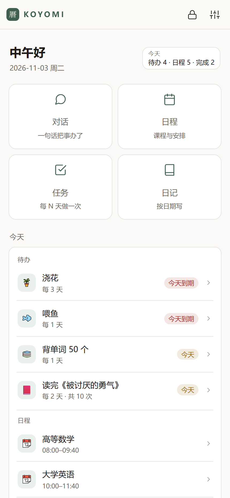
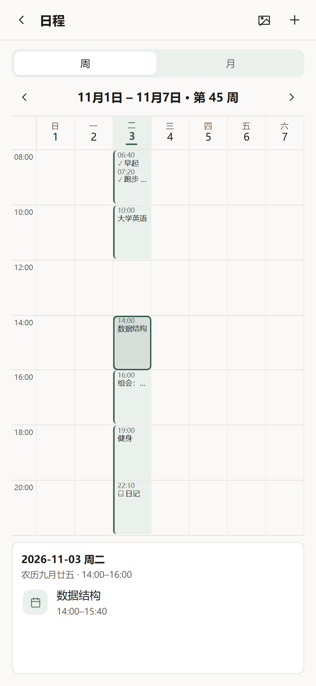

# Koyomi（历）

**本地优先的个人助手**：日程、周期任务、日记、密码库，以及一个能直接读写这些数据的 LLM。

没有账号，没有后端，没有遥测。数据全部存在浏览器本地（IndexedDB），模型用你自己的 API Key 直连。

<p align="center">  
    
    
</p>

## 它解决什么问题

普通的待办 App 里，「记下来」和「改一下」都得你自己点。Koyomi 把两件事放进同一个库：日程、任务、日记是**同一份数据**，聊天框里的助理可以直接调用工具去增删改查——你说「周三下午的组会挪到四点」，它先查 id 再改，改完你还能在周视图里看见。

同时它坚持两条边界：

- **数据不出本机**。没有同步服务器，聊天记录、日记、密码都只在自己的浏览器里。
- **密码库不给模型**。密码模块根本不注册成工具，模型连它的存在都看不到。

## 功能

### 对话

- 只做 OpenAI 兼容协议（`POST /chat/completions`），SSE 流式输出，支持 function calling。
- 一条回复里有多处改动时，确认框会**合并成一次**，而不是连弹三个。
- 工具覆盖：日程增删改查、任务增删改查与完成、日记读写、以及（按预设开放的）记忆/人格自改。
- 三个内置预设：**对话 / 写作 / 心理**。每个预设各自带人格、可用模块、上下文模板和自改权限。
- 上下文模板支持 7 个变量：`{{today}}` `{{now}}` `{{weekday}}` `{{upcoming_events}}` `{{tasks_due}}` `{{diary_titles}}` `{{user_name}}`。
- 历史会话存在本地，可以回看。
- 输入框随内容长高（最多五行左右，再多就在框里滚动）；聊天气泡里的文字可以长按选中、复制。

### 日程

- 周视图按小时排，月视图带农历、节气、法定节假日与调休。
- 节假日内置 2026 年数据；也可以在月历上点「更新」联网拉取（数据来自 [holiday-cn](https://github.com/NateScarlet/holiday-cn)），不自动联网。
- 重复规则：不重复 / 每天 / 每周（支持单双周）/ 每 N 天，可设截止日期。
- 周视图点表头选天、点时间格选小时；底部固定一块当日面板，点条目才进编辑。
- 每条日程在开始前 **5 分钟**弹一次通知栏提醒（仅 App；重复日程按未来 30 天展开，每次打开重排）。
- **日程表识图导入**：拍照或选图 → 视觉模型转成 JSON → 预览确认 → 入库。识别失败会自动重问一次，仍失败可以重试。

### 任务

- 三种形态：一次性 / 每 N 天 / 限次（做够次数自动结束）。
- 完成一次记一条记录，可以撤销（连同到期日一起退回）。
- 首页把逾期任务并进「待办」，不会悄悄消失。
- 图标可选，内置 OpenMoji 的彩色与线条两套画法。

### 日记

- 按日期写，支持心情、置顶、标签和搜索。
- 标签点名字就地改名，用过的那些日记会跟着改，不会留下灰色的孤儿标签。
- 默认**不**交给模型；要开就在对应预设里打开。

### 密码库

- 主密码经 PBKDF2-SHA256（600,000 次）派生密钥，AES-GCM 256 加密；站点名、账号、密码、备注逐字段独立 IV。
- 忘了主密码就打不开，没有找回通道——密钥不可导出。
- 支持从 CSV / 文本批量粘贴导入（认中英文表头、Tab、空格分隔，同名跳过）。

### 备份

- 两档：只导配置（`koyomi-config-*.json`）或连数据一起导（`koyomi-backup-*.json`）。
- 导入含数据的备份会逐表显示条数让你确认。
- 注意：**API Key 默认包含在备份里**（勾选框默认勾上）。备份文件别放网盘。

## 快速开始

需要 Node 22 以上。

```bash
npm install
npm run dev        # http://localhost:5173
```

| 命令                  | 作用                 |
| ------------------- | ------------------ |
| `npm run dev`       | 开发服务器（含模型代理）       |
| `npm run build`     | 类型检查 + 构建到 `dist/` |
| `npm run preview`   | 预览构建产物             |
| `npm test`          | 单元测试（vitest，193 条） |
| `npm run typecheck` | 只做 `vue-tsc` 类型检查  |

首次打开是空库，直接进「日程」或「任务」新建就行。

## 配置模型

进「设置 → 模型」，填三样：Base URL、模型名、API Key。例如：

```
Base URL   https://api.deepseek.com/v1
模型       deepseek-chat
```

识图（导入日程表）是**另一套配置**，可以填和聊天不同的厂商；留空则回落到聊天那套（需要模型支持图片）。

### 浏览器里的跨域问题

网页端直连厂商会受 CORS 限制。有两家默认不放行，所以 `vite.config.ts` 里挂了开发代理：

```
/zhipu/api/paas/v4     → https://open.bigmodel.cn
/opencode/zen/go/v1    → https://opencode.ai
```

把 Base URL 填成上面左边的形式即可。**代理只在 `npm run dev` / `npm run preview` 下生效**；打包成 App 后，非流式请求走 `CapacitorHttp`，不受浏览器跨域限制。

## 打包成 Android App

外壳用 Capacitor，`android/` 是源码，构建产物不入库。

```bash
npm run build
npx cap sync android
cd android
./gradlew assembleDebug        # Windows: gradlew.bat assembleDebug
```

产物在 `android/app/build/outputs/apk/debug/app-debug.apk`。

## 技术栈

- **Vue 3 + TypeScript + Vite 8**，路由用 hash 模式（WebView 里没有 HTTP 服务器，history 模式刷新会 404）
- **Dexie 4**（IndexedDB），表结构只增不改，迁移按版本号叠加
- **Capacitor 8**：本地通知、文件保存、分享、原生 HTTP
- **Vant 4**：只用了少数几个组件，样式以手写 `src/ui/theme.css` 为主
- **markdown-it + DOMPurify**：模型回复先消毒再渲染
- **Vitest**：纯函数与数据层优先覆盖

## 目录结构

```
koyomi-web/
├─ src/
│  ├─ core/              # 与业务无关的地基
│  │  ├─ contracts.ts    # FeatureModule / AppTool / JsonSchema 契约
│  │  ├─ container.ts    # 唯一的模块注册表
│  │  ├─ db.ts           # 表定义、版本迁移、配置读写
│  │  ├─ crypto.ts       # PBKDF2 + AES-GCM
│  │  ├─ timeline.ts     # 事件 / 任务 / 日记合成一条时间轴
│  │  ├─ lunar.ts        # 农历与节气（Intl，无第三方依赖）
│  │  └─ notify.ts       # 本地通知（仅 App，网页端是空函数）
│  ├─ features/
│  │  ├─ llm/            # 对话界面、模型设置、prompt、工具调用循环
│  │  ├─ schedule/       # 周/月视图、重复展开、节假日、日程表识图
│  │  ├─ task/           # 三种任务、到期计算、完成记录
│  │  ├─ vault/          # 日记 + 密码库
│  │  └─ settings/       # 设置、备份导入导出
│  ├─ ui/                # 共用组件、图标、theme.css
│  ├─ tests/             # vitest
│  ├─ HomeView.vue       # 首页「今天」
│  └─ router.ts
├─ android/              # Capacitor 安卓壳（源码入库，产物不入库）
├─ public/               # 网页图标
├─ resources/            # 生成 App 图标的源图
├─ docs/                 # README 截图
├─ capacitor.config.ts
└─ vite.config.ts
```

### 加一个模块

每个功能模块实现 `FeatureModule`，然后在 `core/container.ts` 里加一行：

```ts
export interface FeatureModule {
  id: string
  routes: RouteRecordRaw[]
  homeEntry: { title: string; icon: string; to: string }
  tools?: AppTool[]                        // 给模型的函数；不写 = 模型看不到这个模块
  timeline?: (range) => Promise<DayItem[]> // 参与首页与日视图的时间轴
  defaultModulePrompt?: string             // 这个模块的行为约束
}
```

- 要新表就在 `db.ts` 里加 `this.version(n)`，**只加不改**：删表会连数据一起删掉。
- 不想让模型碰的东西（比如密码库），不实现 `AppTool` 就行。

## 数据与隐私

- 库名 `koyomi`，8 张表：`events` `tasks` `taskLogs` `diary` `config` `vaultEntries` `holidayCache` `chatSessions`。
- 没有同步服务。浏览器和 App 是**两个互不相干的库**（origin 不同），换设备靠备份文件。
- API Key 存在本地 `config` 表里，明文（IndexedDB 本身不加密）。介意的话别在共用电脑上用。
- 密码库的密文无法解开就没有数据，没有后门也没有找回流程。
- 模型回复用 DOMPurify 过滤后才渲染，避免 markdown 里夹带脚本。

## 测试

```bash
npm test        # 15 个文件 / 193 条，全绿
```

覆盖的重点是纯函数和数据层：重复规则展开、到期与逾期判断、时间轴合并、农历与节假日、prompt 变量渲染、SSE 流式回落、加密与备份迁移、识图 JSON 容错。

## 已知限制

1. **跨域**：网页端直连多数厂商会被 CORS 拦；要么用内置开发代理，要么自己搭一层转发。
2. **提醒只在 App 里**：用的是 Capacitor 本地通知；网页端没有 Service Worker，关掉页面就不会提醒，只能等下次打开时检查逾期。
3. **不自动同步**：没有账号体系，多设备靠导出/导入。
4. **识图要人工过一遍**：模型会认错课程名或时间，导入前有预览页可改。
5. **密码库没有找回**：主密码丢了就是丢了。

## 资源与许可

代码是 MIT（见 [LICENSE](LICENSE)），但下面这些资源各有各的许可：

- **任务图标**（`src/assets/task-icons/`）：来自 [OpenMoji](https://openmoji.org/)，图形部分按 **CC BY-SA 4.0** 授权，不适用本项目的 MIT。
  > All emojis designed by OpenMoji – the open-source emoji and icon project. License: CC BY-SA 4.0
- **节假日与调休**：内置的 2026 年数据依据国办发明电〔2025〕7 号；联网更新用 [holiday-cn](https://github.com/NateScarlet/holiday-cn)（MIT）。
- **二十四节气表**：用 [lunar-javascript](https://github.com/6tail/lunar-javascript)（MIT）离线算好后写进代码，运行时不引依赖。
- **农历**：浏览器内置的 `Intl.DateTimeFormat`，没有第三方数据。
- 其余依赖见 `package.json`，均为 MIT / Apache-2.0 等宽松许可。

## 许可

代码以 [MIT](LICENSE) 授权（© 2026 Ayayaneru）；`src/assets/task-icons/` 里的图标另有许可，见上一节。
